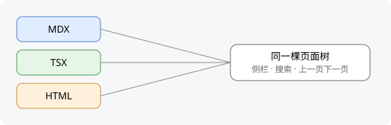

这一页本身就是按它讲的写法写的，可以对照着看。右边的本页目录列出了二到四级标题。

## 文件放在哪

一页说明是 `content/` 里的一个 `.mdx` 文件。文件夹里的 `meta.json` 决定侧栏里的标题和顺序；
`meta.json` 写了 `"root": true` 的文件夹，是侧栏里切换下拉框的一项。站里有这样的文件夹时，不在任何一个里的页面归进以站名命名的一项，排在下拉框最前面。

首页 `/` 不在 `content/` 里：它是 `app/routes/home.tsx`，用 fumadocs 的 `HomeLayout`，顶上一条导航栏，没有侧栏，下面整页由站点自己写。
建站时模板给一份最简单的，之后归站点自己改。`content/` 根上不能放 `index` 页，它的地址也是 `/`，打开首页会报错。

### 文件名与地址

地址就是文件相对 `content/` 的路径，去掉扩展名：

| 文件 | 地址 |
| --- | --- |
| `content/docsite/writing.mdx` | `/docsite/writing` |
| `content/gitea/index.mdx` | `/gitea` |
| `content/(kit)/docsite/skeleton.mdx` | `/docsite/skeleton` |

文件夹名写在括号里（如 `(kit)`）时，它只用来分组，不进地址。

### 页面用到的文件

组件、数据、样式、图片按用到它的范围放，这个站自己就是这样放的：

<Files>
  <Folder name="content" defaultOpen>
    <Folder name="gitea" defaultOpen>
      <File name="meta.json" />
      <File name="index.mdx" />
      <File name="push.mdx" />
      <Folder name="push" defaultOpen>
        <File name="auto-merge.tsx" />
        <File name="auto-merge.data.mjs" />
        <File name="auto-merge.css" />
      </Folder>
    </Folder>
    <Folder name="docsite" defaultOpen>
      <File name="writing.mdx" />
      <Folder name="writing" defaultOpen>
        <File name="figure.svg" />
      </Folder>
    </Folder>
    <Folder name="background" defaultOpen>
      <File name="overview.html" />
      <File name="full-flow.html" />
      <Folder name="_shared" defaultOpen>
        <File name="fig.js" />
        <File name="style.css" />
      </Folder>
    </Folder>
  </Folder>
</Files>

- **只给一页用的**放进和页面同名的文件夹：`push.mdx` 的组件在 `push/`，开头写 `import { AutoMergeRun } from './push/auto-merge'`；
  这一页的图在 `writing/`。TSX 页面 `名字.page.tsx`、HTML 页面 `名字.html` 的文件也放在同名文件夹 `名字/` 里。被页面 import 的正文写成 `_` 开头的 `.mdx`，也放在这里
- **同一组里几页共用的**放进组里 `_` 开头的文件夹：fumadocs 图解的几个 HTML 页共用 `_shared/` 里的脚本和样式
- **几组都要用的**放站点的 `app/components/`。这种情况很少，放之前先问人
- **有子页面的页**写成文件夹加 `index.mdx`：`gitea/index.mdx` 是 `/gitea`，它要用组件就放 `gitea/index/`

`meta.json` 的 `pages` 只写页面名，不写这些文件夹。同名文件夹与 `_` 开头的文件夹里不放页面（不以 `_` 开头的 `.mdx`、`.page.tsx`、`.html`）和 `meta.json`：
fumadocs 解析 `pages` 里的名字时先找文件夹，同名文件夹一旦有页面就被认成一组，同名的那一页从侧栏消失。目录说明只认 `meta.json`，别的 `.json`（数据、导出清单）可以当附件放在这些文件夹里。组文件夹里也不散放组件和图片，只放页面、`meta.json` 与上面这几种文件夹。
放错了，`pnpm build` 直接报错停下；开发服务照常运行，终端里列出每个文件，浏览器底部出现问题按钮，点开能看到是哪些文件、该怎么放，放好后自动消失。协作站提交审核时也查这一项，放错的文件进不了 main。

### frontmatter

文件开头的 frontmatter 写这一页的元数据：

```mdx title="content/docsite/writing.mdx"
---
title: 写一页说明
description: 在 content/ 里写一页 MDX 说明
icon: FileText
---
```

- `title`：页面标题，也是侧栏与搜索结果里的名字
- `description`：标题下面的一句话，也能被搜索到
- `icon`：侧栏里的图标，写 [lucide](https://lucide.dev/icons) 的图标名

## 标题分几级

正文从二级标题开始，一级标题由 `title` 生成。

### 二级标题

一页分成几大块，每块一个二级标题。本页目录列出每个二级标题。

### 三级标题

一块里再分几小节时用三级标题，本页目录里缩进一层。

#### 四级标题

四级标题用来给一小节里的几段起名字，本页目录里再缩进一层。再往下的五级、六级标题很少需要。

## 正文

### 段落与强调

段落之间空一行。**加粗**用来标出一段里最要紧的词，`行内代码`写文件名、命令和标识符。
链接写成 [总览](/docs) 这样，站内链接写地址，不写文件名。

> 引用块放别人的原话，或者需要单独标出来的一句提醒。

### 列表

没有先后的几项用无序列表：

- 布局：docs
- 搜索：`searchServerOf`
- 页面：MDX、TSX、HTML

有先后的步骤用有序列表：

1. 在 `content/` 里新建 `.mdx` 文件
2. 在同一个文件夹的 `meta.json` 里写上它的名字
3. 开发服务里马上能看到新页面

要逐项勾掉的清单：

- [x] 写好 frontmatter
- [x] 正文从二级标题开始
- [ ] 补一张图

### 表格

表格适合列对照，比如三种页面各自的标题从哪来：

| 类型 | 标题从哪来 | 搜索范围 |
| :-- | :-- | :-- |
| MDX | frontmatter 的 `title` | 全文 |
| TSX | 导出的 `meta.title` | 标题和描述 |
| HTML | `<title>` | 正文纯文字 |

## 代码

代码块写上语言，fumadocs 按语言着色；`title` 写文件名。用注释 `// [!code highlight]` 标出要看的那一行：

```ts title="app/lib/source.ts"
export const source = loader({
  source: { mdx: docs.toFumadocsSource(), tsx: tsxPageSource(tsxPageMeta), html: htmlPageSource(htmlPageText) }, // [!code highlight]
  baseUrl: '/',
  plugins: [lucideIconsPlugin(), ...featureRuntime.pageTreePlugins],
})
```

命令行写成 `bash`：

```bash
pnpm doc
```

## 公式

公式用 KaTeX 的写法。行内的写在一对 `$` 里，单独成一行的写在一对 `$$` 里：

```mdx
DAB 传输功率是 $P = \frac{n V_1 V_2}{2 f L} D (1 - D)$，其中 $D$ 是移相比。

$$
T_f(z) = \frac{1}{2\pi i} \oint_\gamma \frac{f(w)}{w - z} \, dw
$$
```

DAB 传输功率是 $P = \frac{n V_1 V_2}{2 f L} D (1 - D)$，其中 $D$ 是移相比。

$$
T_f(z) = \frac{1}{2\pi i} \oint_\gamma \frac{f(w)}{w - z} \, dw
$$

公式写错了，页面上把原式标红显示；提交前的检查按同样的规则编译，写明哪个文件第几行的公式错在哪，拒绝提交。TSX 页面里用平台包 `@godcreator/god-docsite/tex` 的 `Tex` 组件：`` <Tex>{String.raw`\frac{a}{b}`}</Tex> ``，加 `block` 单独成一行。

## 图片

图片放进页面的同名文件夹（这一页是 `writing.mdx`，图在 `writing/`），用相对路径引用，构建时一起打包：



点图片可以放大看。TSX 页面和 MDX 里直接写的 `` 标签不会自动放大，换成平台的 `ImageZoom`：MDX 里不用 import，TSX 页面从 `@godcreator/god-docsite/react` 引入。
页面上放压缩过的图、放大时才加载高清版的，加 `zoomSrc`：`<ImageZoom src={small} zoomSrc={large} alt="…" />`。

## 链接

站里的链接写地址，显示成带图标的小卡片。链接文字空着时，卡片上是目标现在的名字，目标改了名字这里跟着变；写了文字就照写的显示：

```mdx
[](/docs) 和 [总览](/docs)
[](/docsite/writing-components#折叠)
[](/docsite/writing?comment=20261012t153000-ab12)
[](/comments)
[](/api/content/docsite/writing/figure.svg)
[](/no-such-page)
[fumadocs](https://fumadocs.dev)
```

[](/docs) 和 [总览](/docs)

[](/docsite/writing-components#折叠)

[](/docsite/writing?comment=20261012t153000-ab12)

[](/comments)

[](/api/content/docsite/writing/figure.svg)

[](/no-such-page)

[fumadocs](https://fumadocs.dev)

依次是：页面、页面里的一节、一串评论（写出它批的页面与锚点）、侧栏那一排的入口、`content/` 里的文件（开新标签页）、
找不到的页面（标红）、站外的网页（后面带箭头，开新标签页）。只写 `#标题` 的链接跳到本页的那一节，照常显示成文字链接。

功能自己的页面不在侧栏的页面树里，由功能告诉站点哪些地址存在（`feature.tsx` 导出的 `linkKinds`）。比如轨迹卡里写
`[起始卡](2026-01-01-site-born.md)` 指向另一张卡，链接改写成卡页地址，卡还在就显示成卡片（没写文字时显示卡身份），卡不在了标红。

## 脚注

需要补一句又不想打断正文时用脚注[^1]。

[^1]: 脚注集中显示在页面最后。
