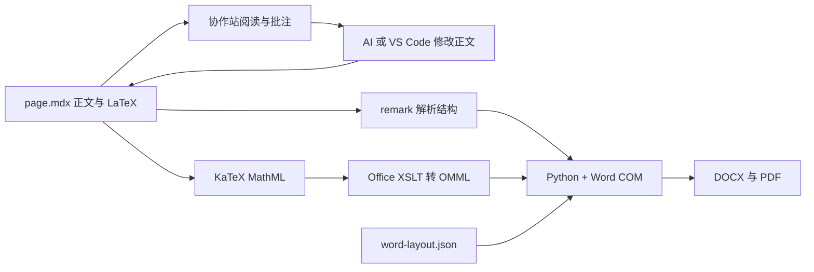

# 协作站到 Word 实验

本仓验证：在协作站阅读和批注，AI／VS Code 修改同一份正文，然后通过本机 Microsoft Word 导出正式版式。它与同单元下的 `word-conversion-lab/` 是两个独立 Git 仓；另一仓负责比较 Word 生成技术路线。

## 打开与编辑

试验站：http://127.0.0.1:4342/report/sst-sample

正文正本是 `site/pages/report/sst-sample/page.mdx`，图片和 `word-layout.json` 放在同目录。浏览器中的「导出 Word」读取已保存的正文，调用本仓 `.venv` 内的 Python，再通过本机 Word COM 生成 DOCX 和 PDF。每次导出使用新的 `out/web-…/`，其中保存这次实际使用的正文快照、版式、解析结果和校验记录。

当前沿用已有协作站方式：网页阅读、段落批注；正文、公式和表格通过 AI／VS Code 改源文件。本站没有增加网页正文编辑器。本地实验身份为 `lab-author`，未接入 Gitea、远端同步或多用户并发；浏览器批注保存在 `collab/records/`，不混进交付报告正文。

## 流程与边界



Word 负责段落、标题、表格、图片、页眉页脚、横向节、自动目录、公式 SEQ 编号以及最终分页。公式共用一份 LaTeX；网页用 KaTeX 渲染，导出使用 KaTeX MathML → Office 自带 MML2OMML.XSL → Word 原生公式。公式没有固定六条映射，也没有转成图片。

实验导出器支持明确的 Markdown 子集：标题、段落、列表、GFM 表格、等宽代码块、同目录图片、HTTP(S) 链接、行内与独立公式，以及章节版式标记。除报告导出控件外，不执行或忽略任意 MDX 组件；不支持的节点会明确报错。任意 React 交互页、合并单元格、脚注、MathType OLE、修订记录与 Word 反向导回网站尚未纳入本实验。

## 样例来源

样例取自提供的 SST 报告，参考之前 54 页排版版本第 6–7、10、18–19、37–38、42–43、49 页。按完整段落和完整表格取样，因此保留部分邻页续文。正文重新组成六个节选章节，保留原图表题号和跨章引用，章节引用仍指原完整报告。

一次性取样程序是 `routes/word-com/import_sample.py`；取样记录在正文旁的 `source.json`。两条完整公式从原文普通文字等价整理成 LaTeX，其余原生根号导出到 LaTeX。日常导出仅依赖本仓正文与图片，不再读取原始 DOCX。

覆盖场景：多级标题、中英文、项目列表、等宽拓扑框图、六张参数与对比表、重复表头、纵向跨页、横向宽表、两幅原始图片、图题、行内／独立／表内公式、外部来源链接、页码、自动目录与独立公式编号。

## 运行

Python 使用仓内 `.venv`，依赖版本固定在 `requirements.txt`。本机需安装 Microsoft Word；Office 的 `MML2OMML.XSL` 默认路径在导出器中明确指定。Node、pnpm 使用本机已配置的工具链；未使用系统 Python 库。

```powershell
# 在仓根；$basePython 只用于创建 venv。
& $basePython -m venv .venv
& ./.venv/Scripts/python.exe -m pip install -r requirements.txt

# 站点：在 site/ 下运行。
pnpm install
pnpm start
pnpm check

# 命令行导出：在仓根，输出目录每次换一个新名称。
& ./.venv/Scripts/python.exe -X utf8 routes/word-com/export_page.py out/manual-01
```

源码、图片、协作记录与依赖清单进 Git；`.venv/`、`node_modules/` 与 `out/` 被 Git 忽略。生成物位于 `out/`，沿用本机 Restic 对该目录名的排除规则。

## 验证记录

本轮导出为 10 页、6 张表、2 张图、15 个原生公式、3 个方向节、1 个自动目录和 2 个公式编号域；横向表位于第 6–7 页。逐页检查已覆盖目录、跨页续表、图片与公式，纵向长表和横向宽表都重复表头。

验证结果：

- 浏览器实际完成段落批注，记录落入 `collab/records/`。
- 浏览器「导出 Word」实际启动本机 Word，成功后提供 DOCX 下载和 PDF 预览；正文修改后会提示旧导出已过期。
- 临时修改一句正文、将一个表格参数从 100kW 改为 101kW，并将公式分母 `8 f_s L` 等价改为 `8 L f_s`。网页三项均更新，再导出的 DOCX 三项均更新。完成后恢复原文、原参数与原公式；修改副本仅留作 `out/edit-cycle/` 的验证证据。
- 在独立 DOCX 副本中，将原生分式分母的 8 改为 9，保存重开后修改仍存在，15 个公式对象保留；交付报告没有此改动。
- 247 个表格单元格逐格匹配、15 个公式语义结构匹配、两张图片字节一致，12 处来源链接的 6 个不同目标保留。

首次遇到的 Word 图片自动压缩已修复：先用 Word 创建空白文档，在其 DOCX 设置中关闭自动压缩，再由 Word COM 插入原图和全部正文。公式插入使用 Word 自己生成的完整 Flat OPC 容器，再以原生格式复制到目标段落或表格，避免把公式拆成图片或破坏单元格。

每次导出后自动运行独立内容检查，失败不会在网页显示为成功。最终文件路径由 `out/last-export.json` 记录；相应目录内的 `source.mdx`、`word-layout.json`、`verification.json`、`content-check.json` 可核对本次使用的源版本。页面渲染检查是本轮人工完成的，后续新增内容仍需查看导出 PDF。
