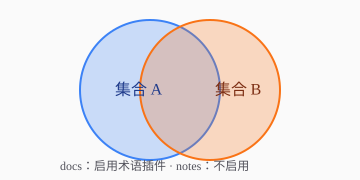

表格、代码块、公式这些都不用 import：组件表（`app/mdx-components.ts`）登记的是锁定版 Fumadocs 公开组件。

## 表格

| 组件 | 来自 | 备注 |
| --- | --- | --- |
| Tabs | `@fumadocs/base-ui/components/tabs` | 一次只看一种写法 |
| TypeTable | `@fumadocs/base-ui/components/type-table` | 参数说明 |
| img | `ImageZoom` | 点了放大 |

## 代码块

```ts title="collections.ts" {3}
import { defineDocs } from 'fumadocs-mdx/macro'

// 集合 A：术语插件只对它生效
export const docs = defineDocs({ dir: 'content/docs' })
```

行内代码里的术语不标：`命令总线`。

## 公式

行内 $e^{i\pi} + 1 = 0$ 与块级：

$$
\int_0^\infty e^{-x^2}\,dx = \frac{\sqrt{\pi}}{2}
$$

公式里的词不标：$命令总线 + x$。

## 标签页

<Tabs items={['pnpm', 'npm']}>
  <Tab value="pnpm">

  ```bash
  pnpm install
  ```

  </Tab>
  <Tab value="npm">

  ```bash
  npm install
  ```

  </Tab>
</Tabs>

## 文件树

<Files>
  <Folder name="fixture-site" defaultOpen>
    <Folder name="app" defaultOpen>
      <File name="source.config.ts" />
      <File name="routes.ts" />
    </Folder>
    <Folder name="content" defaultOpen>
      <Folder name="docs" defaultOpen>
        <File name="writing-demo.mdx" />
      </Folder>
      <Folder name="notes">
        <File name="index.mdx" />
      </Folder>
    </Folder>
  </Folder>
</Files>

## 折叠

<Accordions>
  <Accordion title="术语为什么不在浏览器里查表">
    定义在构建期写成 Term 的属性，组件是纯展示的，客户端包里不用带词表。
  </Accordion>
  <Accordion title="为什么一篇只标第一次">
    标注是为了解释，不是为了统计词频；满页虚线反而没法读。
  </Accordion>
</Accordions>

## 图片

点一下放大：



## 参数表

<TypeTable
  type={{
    terms: { type: 'TermEntry[]', description: '术语表，构建期由 source.config.ts 读入', required: true },
    skipFile: { type: '(path: string) => boolean', description: '哪些文件不标：术语页自己要跳过（集合分发由集合配置负责）' },
  }}
/>
